# What this fork adds

A tour of everything this fork adds to [LMN-3-DAW](https://github.com/FundamentalFrequency/LMN-3-DAW), with pictures. All screenshots are from the real app at the LMN-3's own 800 × 480 resolution.

The four boxes along the bottom of most screens always match the LMN-3's four encoders, left to right. Hold **Control** for a screen's second set of controls ("ctrl: more" in the top right means there is one).

- [Look and feel](#look-and-feel)
- [Projects, editing and rendering](#projects-editing-and-rendering)
- [Instruments](#instruments)
- [Effects and the plugin chain](#effects-and-the-plugin-chain)
- [MIDI FX](#midi-fx)
- [Modulation](#modulation)
- [Sequencers](#sequencers)
- [Mixer](#mixer)
- [VST3 plugins](#vst3-plugins)
- [Power off](#power-off)
- [Sounds: Starter kit and OP-1 converter](#sounds-starter-kit-and-op-1-converter)
- [Windows and Android versions](#windows-and-android-versions)

---

## Look and feel

Every screen is redrawn in a "playful" style: a dark purple background, rounded cards, and a small animated character for each instrument, effect, modulator and sequencer that reacts as you play. The original's plain lists and knobs are gone.

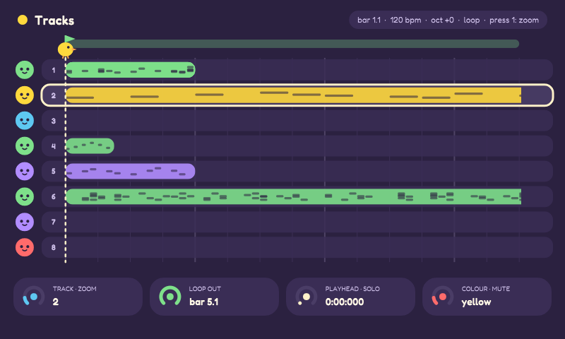 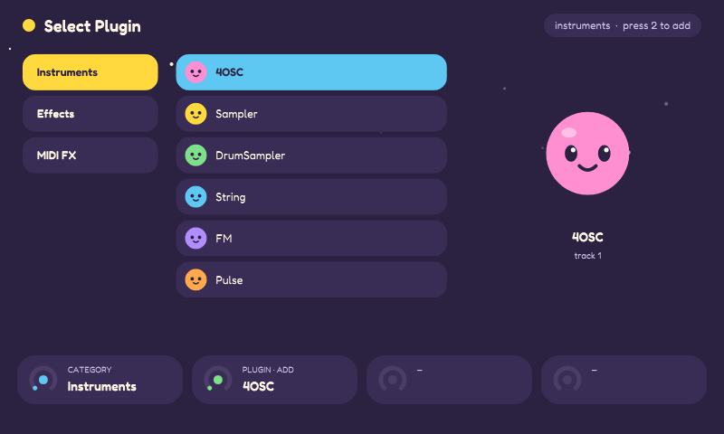

- **Tracks** (left): each track's clips with their notes. The chick is the playhead; the green bar above is the loop range.
- **Select Plugin** (right): categories on the left (encoder 1), plugins in the middle (encoder 2), and a preview of the plugin's character. Press encoder 2 to add it.

Animations can be turned off in `config.yaml` (`animations: false`) to save CPU.

## Projects, editing and rendering

- **Several projects:** Settings → Projects lists them ("Project 1", "Project 2", …). Open one, or start a new one. They live in `~/.config/LMN-3/projects`.
- **Quantize with swing:** Control + Cut on the Tracks screen snaps the selected clip's notes to the grid, with adjustable swing.
- **Render menu:** render the whole song, or just the loop range, either as one mix or as **stems** (one file per track, muted tracks left out).
- **Undo:** Control + Loop (or the Undo button).
- **Sampler fixes:** each track's sampler keeps its own view and settings.

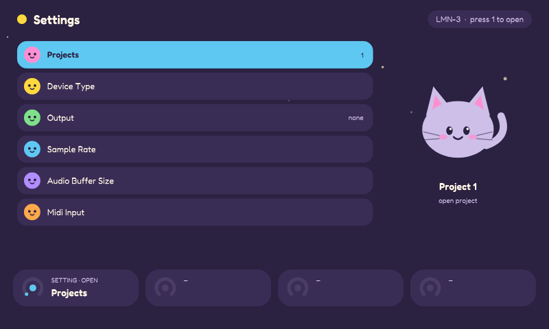

## Instruments

Besides the original 4OSC and Sampler, there are three new synth engines and a drum sampler. Each has its own animated screen.

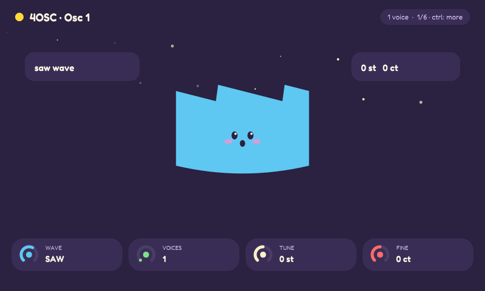 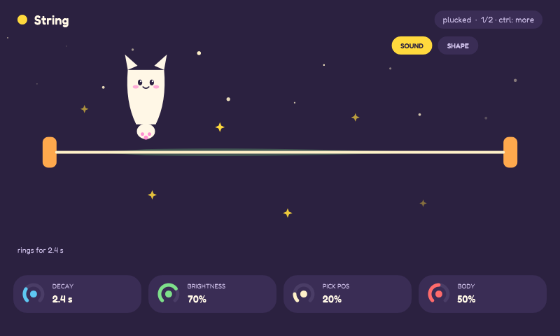

- **4OSC** (left): the original four-oscillator synth, now drawn as its waveform. Pages for each oscillator, the filter and the envelopes.
- **String** (right): a plucked-string model. Decay, brightness, pick position and body; the string vibrates when you play.

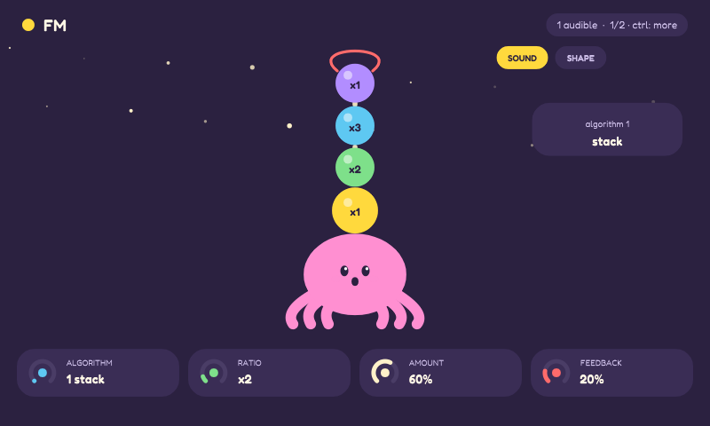 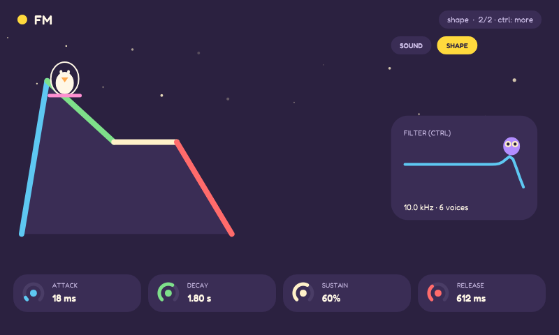

- **FM**: FM synthesis with a stack of operators (the bubbles), algorithm, ratio, amount and feedback.
- **Shape page** (right, shared by the new engines): the envelope drawn as a slope, plus the filter (Control).

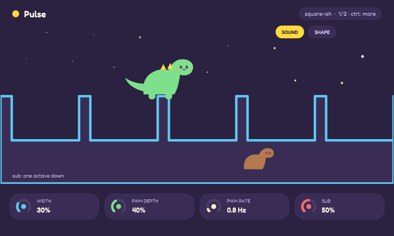 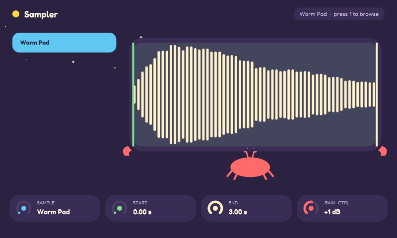

- **Pulse** (left): a pulse-wave synth with pulse width, PWM depth and rate, and a sub oscillator one octave down.
- **Sampler** (right): the sample's waveform with its start and end points. Press encoder 1 to browse your samples.

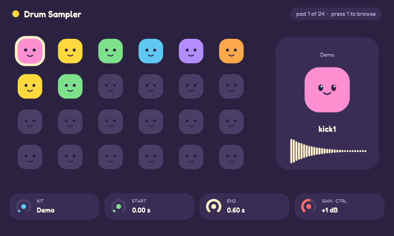

- **Drum Sampler**: 24 pads, one per key, loaded from a drum kit folder. Pick the kit with encoder 1, then set each pad's start, end and gain.

## Effects and the plugin chain

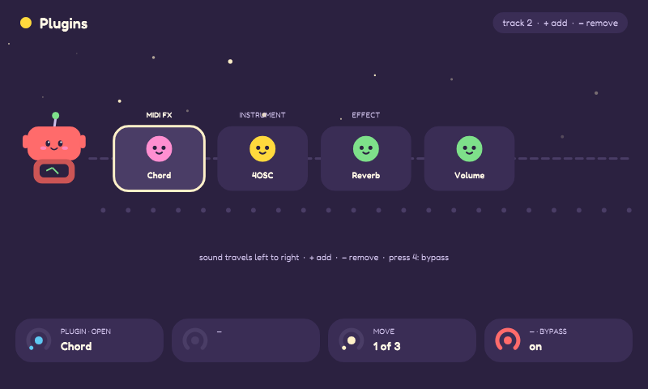 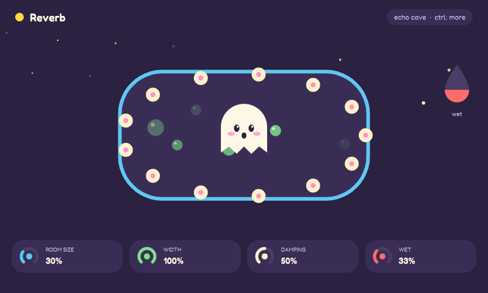

- **Plugins screen** (left): a track's chain, left to right in the order the sound travels: MIDI FX → instrument → effects → volume. Add with +, remove with −, move a plugin with encoder 3, bypass with encoder 4.
- **Effects**: 4-band equaliser, reverb (right), delay, chorus, phaser, compressor, low/high-pass filter and a new **Pitch Shift**. Each one has its own animated screen.

## MIDI FX

MIDI FX sit before the instrument and change the notes you play.

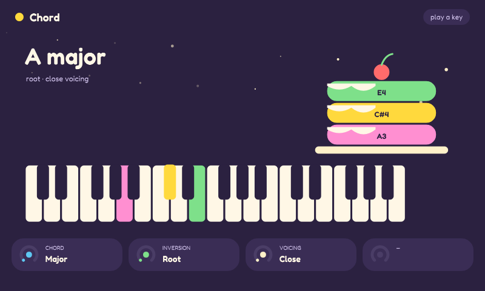

- **Chord** (above): one key plays a whole chord. Choose the chord type, inversion and voicing; the keyboard shows the notes and the cake stacks them.
- **Arpeggiator**: plays held notes one after another: mode (up, down…), rate, octaves, gate and latch.
- **Scale lock**: keeps every note in a chosen root and scale, so nothing sounds wrong.

## Modulation

Modifiers move a knob for you. Adding one takes three steps: choose the modifier, then the plugin, then the knob it should turn.

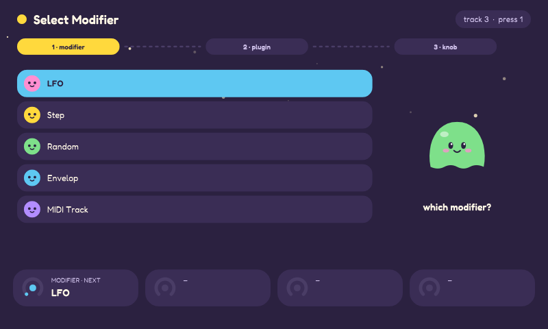 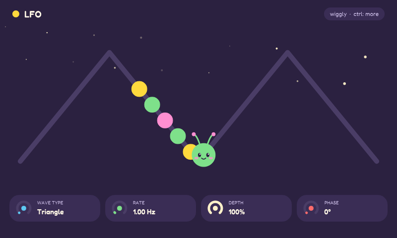

- **LFO** (right): a repeating wave (triangle, sine, square…) with rate, depth and phase.
- **Step**: a short sequence of knob positions, in time with the song.
- **Random**: a new random value at a set rate, smoothed or not.
- **Envelope**: follows how loud a sound is (an envelope follower).
- **MIDI Tracker**: follows the notes or velocities you play.

## Sequencers

The Sequencers screen lists five sequencers. Opening one puts a new clip at the playhead, with the pattern you last used, and sets the loop around it.

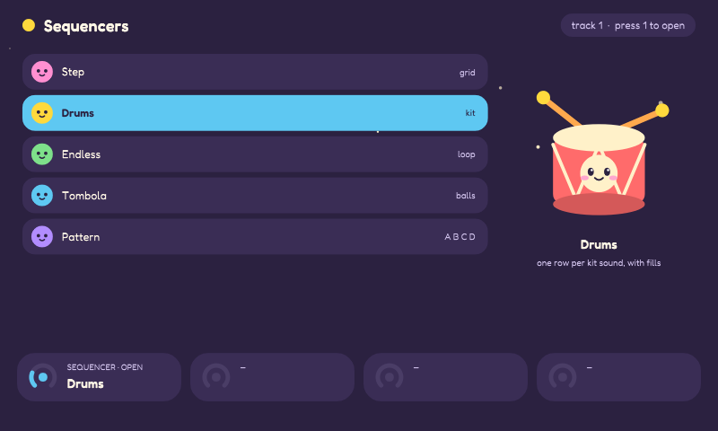 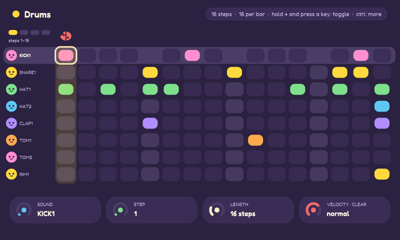

- **Drums** (right): one row per sound of the track's drum kit, 16 steps per bar. Select a step with encoder 2, hold + and press the keys of the sounds to put there. Fills, length and per-step velocity are on the encoders.

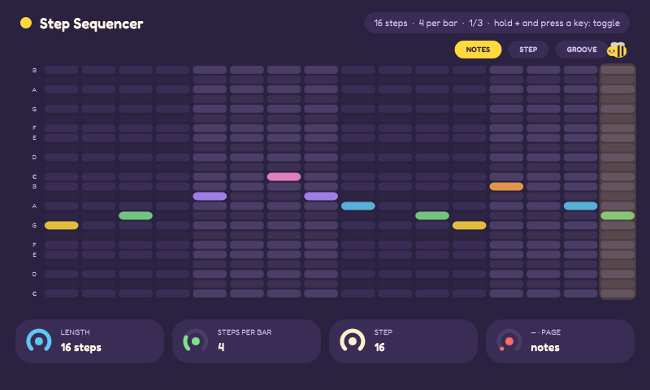 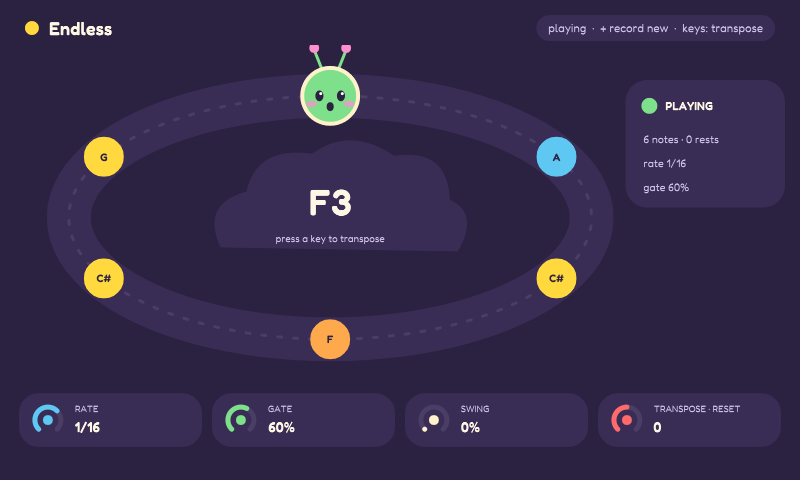

- **Step** (left): a note grid with per-step tricks: Notes, Step and Groove pages, any length and steps per bar. Hold + and press keys to enter notes; the step moves on by itself.
- **Endless** (right): press +, play some notes, press + again: they loop forever. While it plays, pressing a key transposes the loop live. Rate, gate and swing on the encoders.

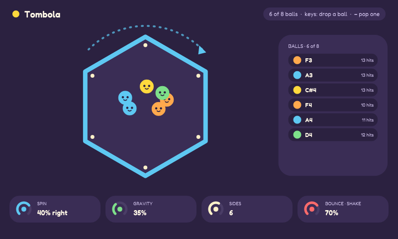 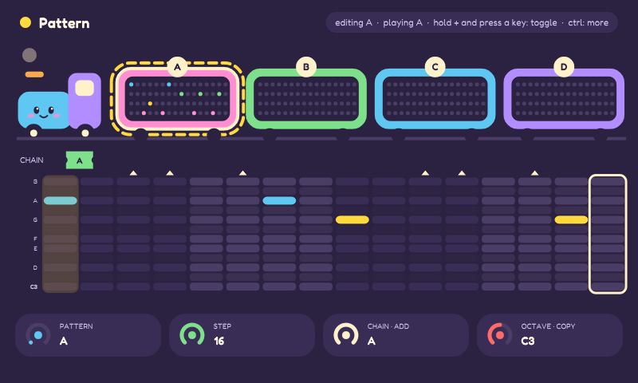

- **Tombola** (left): each key you press drops a ball into a spinning shape; every bounce off a wall plays the ball's note. Spin, gravity, number of sides and bounce on the encoders.
- **Pattern** (right): four patterns, **A** to **D**, drawn as train carriages. Chain them in any order (the chain row under the train), copy one to another, and shift octaves.

## Mixer

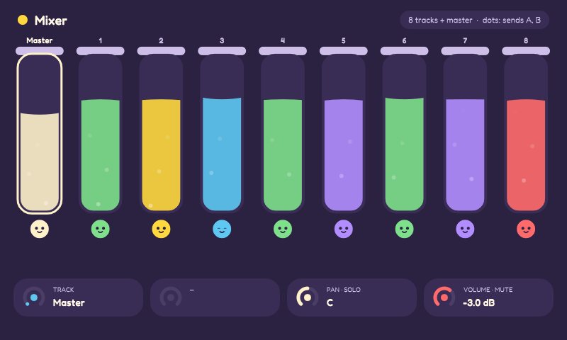

Each track is a test tube showing its level, with the master on the left. Encoder 3 is pan (Control: solo), encoder 4 is volume (Control: mute). The small dots above each tube are the **aux sends A and B**, for sharing one reverb or delay between tracks.

## VST3 plugins

VST3 instruments and effects installed in `~/.vst3` or `/usr/lib/vst3` (for example Dexed and OB-Xd) appear in Select Plugin. They are scanned once and remembered. Their parameters are grouped into pages of four, one per encoder, with ready-made **knob maps** for popular plugins (editable in `~/.config/LMN-3/knob_maps`) and a **preset browser**. See the README's "VST3 Plugins" section.

## Power off

Hold **Control + Stop** for 3 seconds: the project is saved and the Pi shuts down safely.

## Sounds: Starter kit and OP-1 converter

- **Starter kit:** a free 16-sound drum kit made from scratch ([`drum_kits/Starter`](drum_kits/Starter)), ready for the Drum Sampler.
- **`tools/op1_to_lmn3.py`:** turns OP-1 drum patches into drum kits, OP-1 sampler patches into samples, and folders of ordinary one-shots into kits, sorted into a sensible key order (kicks first, then snares, claps, hats, toms…).

How to use both: [docs/SAMPLES.md](docs/SAMPLES.md).

## Windows and Android versions

The same app also runs without the LMN-3 hardware, to try it out or to sketch ideas away from it. Download both from the [Actions tab](https://github.com/HotPTgz/LMN-3-DAW/actions) (newest green run → Artifacts).

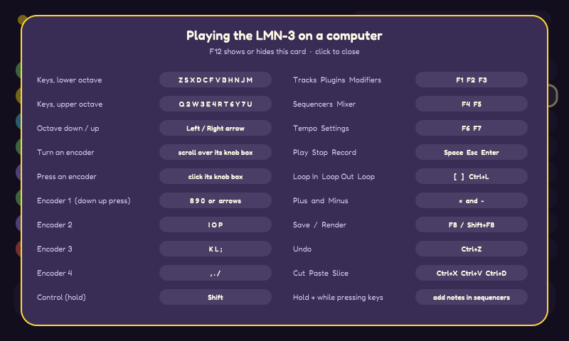

- **Windows** (above): the computer keyboard is the LMN-3. Two rows of letters are the 24 keys, the F-keys are the buttons, and you scroll over a knob box to turn an encoder. Press F12 for this cheat sheet.

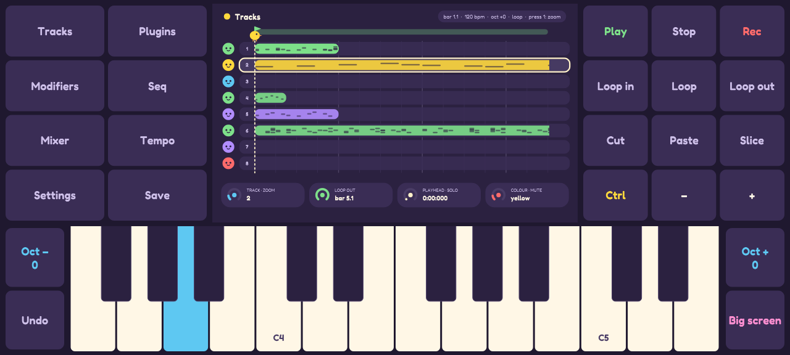

- **Android** (above): the LMN-3 screen in the middle, its buttons on both sides and two octaves of multi-touch keys. Drag a knob box to turn an encoder and tap it to press. "Big screen" hides the keys. Samples and drum kits go in `Android/data/com.fundamentalfrequency.lmn3/files/LMN-3` (visible when the phone is plugged into a computer). VST3 plugins aren't available on Android.
