# LMN-3-DAW (extended fork)
[](https://www.gnu.org/licenses/gpl-3.0)

**A bigger, friendlier software for the [LMN-3](https://github.com/FundamentalFrequency) DIY groovebox.** This is a fork of [FundamentalFrequency/LMN-3-DAW](https://github.com/FundamentalFrequency/LMN-3-DAW) by Stone Preston. It runs on the same LMN-3 you already built, with no hardware changes, and keeps everything the original does. On top of that, every screen is redrawn, and it adds three new synths, five sequencers, MIDI effects, more modulation, VST3 plugins, several projects, and Windows and Android versions.

> **You're on the `lmn3-v3-wide` branch:** the software for [Limoncello](https://github.com/HotPTgz/Limoncello), a new hardware design based on the LMN-3 (7.9" 1280 × 400 screen, built-in speakers and mic). It has everything in `lmn3` plus the [Limoncello features](#limoncello). For an original LMN-3, use the [`lmn3` branch](https://github.com/HotPTgz/LMN-3-DAW/tree/lmn3).

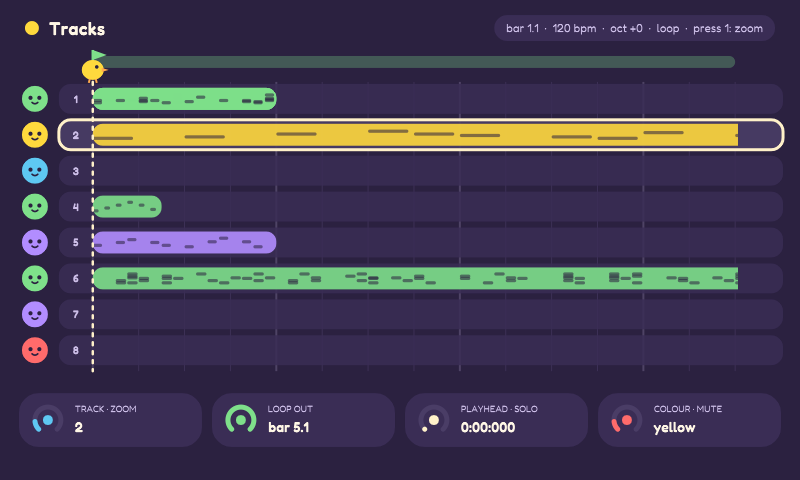 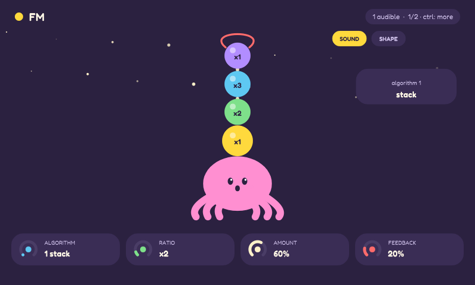 
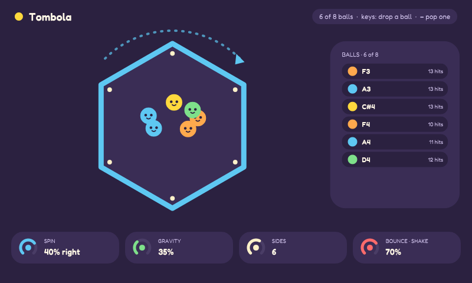 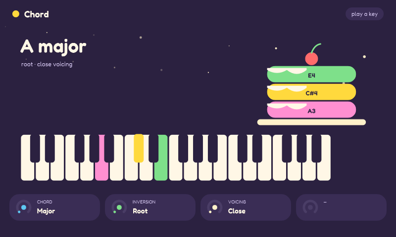 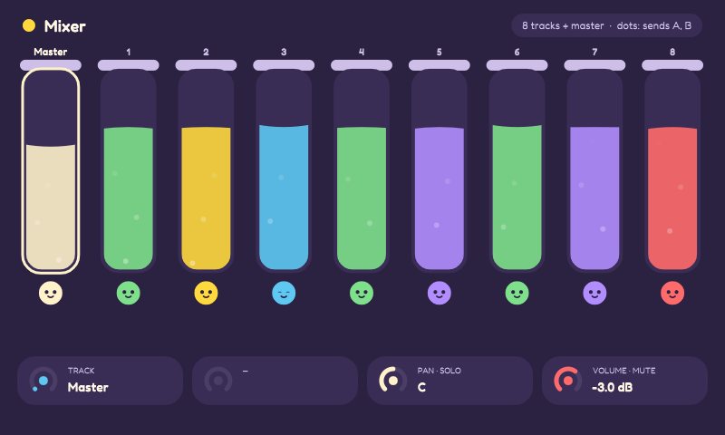

**Contents:** [Install or update](#install-or-update-on-your-lmn-3) · [Limoncello](#limoncello) · [Windows and Android](#windows-and-android) · [What's new](#whats-new) · [Sounds](#sounds-samples-and-drum-kits) · [Settings](#settings-configyaml) · [Branches](#branches) · [Credits](#thanks)

## Install or update on your LMN-3

You build the app on the LMN-3's Raspberry Pi and swap it in for the original. Your projects, samples, drum kits and settings in `~/.config/LMN-3` are kept. If you had the original's single project, it moves into the new Projects list by itself.

**You need:** the LMN-3's Pi 4 or Pi 5 running the **64-bit** Raspberry Pi OS, at least 4 GB of RAM, a network connection, and a keyboard or an SSH connection (for example PuTTY from Windows). The first build takes a while (an hour or so); later updates are much quicker.

### 1. Install the build tools (once)

```bash
sudo apt update
sudo apt install git build-essential cmake clang llvm lld \
    libasound2-dev libjack-jackd2-dev ladspa-sdk libcurl4-openssl-dev \
    libfreetype6-dev libx11-dev libxcomposite-dev libxcursor-dev libxext-dev \
    libxinerama-dev libxrandr-dev libxrender-dev libglu1-mesa-dev mesa-common-dev
```

### 2. Download the code (once)

```bash
cd ~
git clone --recurse-submodules -b lmn3-v3-wide https://github.com/HotPTgz/LMN-3-DAW LMN-3-DAW-extended
```

### 3. Build it

```bash
cd ~/LMN-3-DAW-extended
cmake -B build -DCMAKE_CXX_COMPILER=clang++ -DCMAKE_C_COMPILER=clang \
      -DCMAKE_BUILD_TYPE=Release -DCMAKE_CXX_FLAGS=-fuse-ld=lld -DPACKAGE_TESTS=OFF
cmake --build build --target LMN-3 -j4
```

When it finishes, the new app is `build/LMN-3_artefacts/Release/LMN-3`. If the build stops with an out-of-memory error, run the second command again with `-j2`.

### 4. Swap it in

The standard LMN-3 setup starts a file called `LMN-3` in the Pi's home folder. Keep the original as a backup and put the new one in its place:

```bash
mv ~/LMN-3 ~/LMN-3.original
cp ~/LMN-3-DAW-extended/build/LMN-3_artefacts/Release/LMN-3 ~/LMN-3
sudo reboot
```

If your LMN-3 starts the app from somewhere else, find it while the app is running with `ps -ef | grep LMN-3`, and use that path in place of `~/LMN-3`.

**To go back to the original:** `cp ~/LMN-3.original ~/LMN-3` and reboot.

### Updating later

```bash
cd ~/LMN-3-DAW-extended
git pull
git submodule update --init --recursive
cmake --build build --target LMN-3 -j4
cp build/LMN-3_artefacts/Release/LMN-3 ~/LMN-3
sudo reboot
```

Only the parts that changed are rebuilt.

### Good to know

- **Adding sounds:** see [Sounds](#sounds-samples-and-drum-kits). A free Starter drum kit is included.
- **Switching off:** hold **Control + Stop** for 3 seconds to save and shut the Pi down safely.
- **Testing on a computer:** you can also build and run it on a Linux computer with the same commands. Start it with `LMN3_KEYBOARD=1` to play it with the computer keyboard (F12 shows the keys).

## Limoncello

### Wide screens (Limoncello, 7.9" 1280 × 400)
This branch is the software for [Limoncello](https://github.com/HotPTgz/Limoncello), the LMN-3 successor with Hall-effect keys and a 7.9" screen.

Any window more than 2.2 times as wide as it is tall gets the wide layout: the header runs across the top, the screen's
picture fills the left, and the four knob boxes sit in a 2 × 2 panel on the right, in the same order as the v3's
encoders (1 2 on top, 3 4 below). For the Waveshare 7.9" monitor set:
```yaml
config:
  show-title-bar: false
  size:
    width: 1280
    height: 400
```
The monitor starts in portrait (400 × 1280). Turn it sideways in Raspberry Pi OS with **Screen Configuration**
(Layout → Orientation), or on the command line with `wlr-randr --output HDMI-A-1 --transform 90`
(use the output name `wlr-randr` lists, and `270` if the picture is upside down).

### Limoncello controls
These need the [Limoncello Teensy firmware](https://github.com/HotPTgz/Limoncello/tree/main/firmware) (it sends CC 113–116):

| Control | What it does |
| --- | --- |
| Joystick click | Sustain, like a sustain pedal, while held (4OSC, String, FM, Pulse) |
| Joystick left/right | Pitch bend, ±2 semitones on String, FM and Pulse (4OSC has its own range) |
| Control + joystick click | Switches the joystick's up/down mod wheel on or off (the firmware remembers it). On String, FM and Pulse the mod wheel is vibrato, up to ±50 cents; many VST3 synths use it too |
| Control + Tempo | Switches key velocity on or off: off plays every note at the same velocity (100). The firmware remembers it |
| MIC | Arms the built-in mic on the selected track: the next **Record** records sound from it. MIC again turns it off. The mic is never played through the speakers, so it can't howl. |
| Control + MIC | Samples: make a sound and press MIC again (it stops by itself after 20 s). The silence around it is trimmed. A drum sampler asks which pad to put it on (play the key), a sampler gets it across the keys, and a track with no instrument gets a new sampler. It is always saved in `samples/Recorded` too. |

On a computer (`LMN3_KEYBOARD=1`), F9 is MIC and F10 the joystick click. `LMN3_FAKE_MIC=1` replaces the mic with a
test tone for sampling, for computers without one.

## Windows and Android

The same app runs without the LMN-3 hardware, to try it out or sketch ideas away from it. GitHub builds both automatically. Open the [Actions tab](https://github.com/HotPTgz/LMN-3-DAW/actions), click the newest run with a green tick for the `lmn3-v3-wide` branch, and download from **Artifacts** at the bottom.

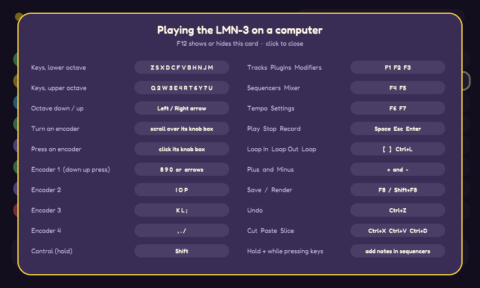

- **LMN-3-windows:** unzip it and double-click `LMN-3.exe`. If Windows says it protected your PC, click **More info**, then **Run anyway**. The computer keyboard is the LMN-3: two rows of letters are the 24 keys, the F-keys are the buttons, and scrolling over a knob box turns that encoder. **F12** shows the cheat sheet above. Sounds go in `%APPDATA%\LMN-3`.

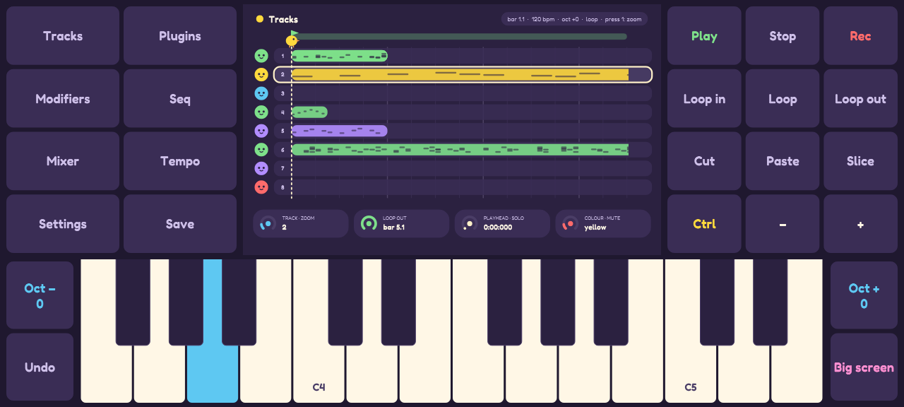

- **LMN-3-android:** unzip it on the phone and open `LMN-3.apk`, allowing installs from that app when asked. Hold the phone sideways. The LMN-3 screen is in the middle, its buttons on both sides and two octaves of multi-touch keys below. Drag a knob box to turn an encoder and tap it to press. **Big screen** hides the keys. Sounds go in `Android/data/com.fundamentalfrequency.lmn3/files/LMN-3`, visible when the phone is plugged into a computer. VST3 plugins aren't available on Android.

## What's new

The four boxes along the bottom of most screens always match the LMN-3's four encoders, left to right. Hold **Control** for a screen's second set of controls ("ctrl: more" in the top right means there is one).

### Look and feel

Every screen is redrawn in a "playful" style: a dark purple background, rounded cards, and a small animated character for each instrument, effect, modulator and sequencer that reacts as you play. The original's plain lists and knobs are gone.

 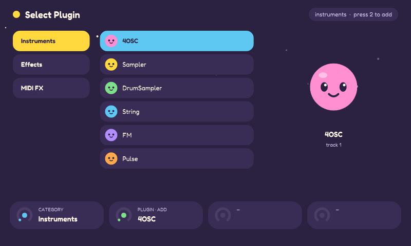

- **Tracks** (left): each track's clips with their notes. The chick is the playhead; the green bar above is the loop range.
- **Select Plugin** (right): categories on the left (encoder 1), plugins in the middle (encoder 2), and a preview of the plugin's character. Press encoder 2 to add it.

Animations can be turned off in `config.yaml` (`animations: false`) to save CPU.

### Projects, editing and rendering

- **Several projects:** Settings → Projects lists them ("Project 1", "Project 2", …). Open one, or start a new one. They live in `~/.config/LMN-3/projects`.
- **Quantize with swing:** Control + Cut on the Tracks screen snaps the selected clip's notes to the grid, with adjustable swing.
- **Render menu:** render the whole song, or just the loop range, either as one mix or as **stems** (one file per track, muted tracks left out).
- **Undo:** Control + Loop (or the Undo button).
- **Sampler fixes:** each track's sampler keeps its own view and settings.

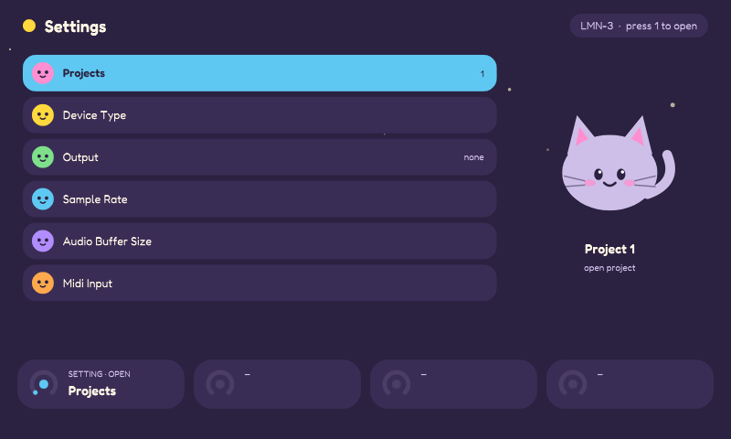

### Instruments

Besides the original 4OSC and Sampler, there are three new synth engines and a drum sampler. Each has its own animated screen.

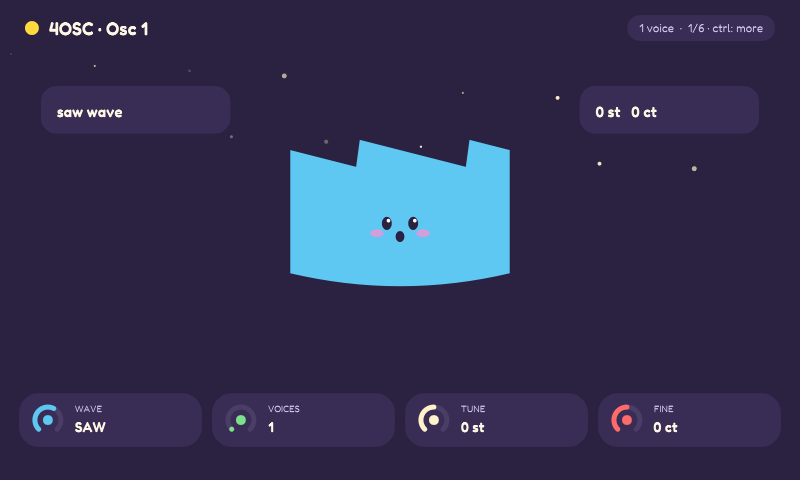 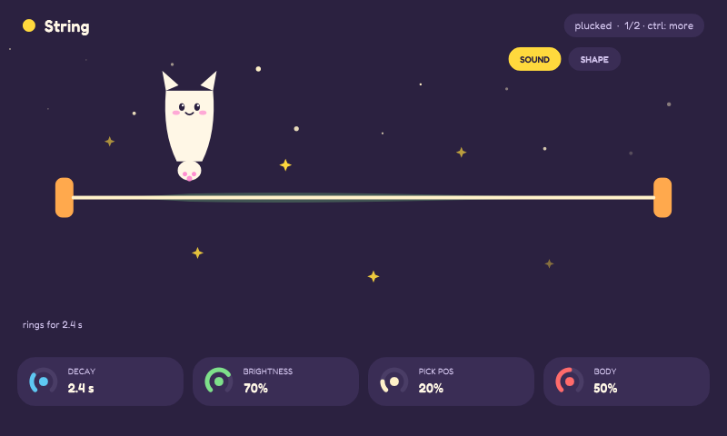

- **4OSC** (left): the original four-oscillator synth, now drawn as its waveform. Pages for each oscillator, the filter and the envelopes.
- **String** (right): a plucked-string model. Decay, brightness, pick position and body; the string vibrates when you play.

 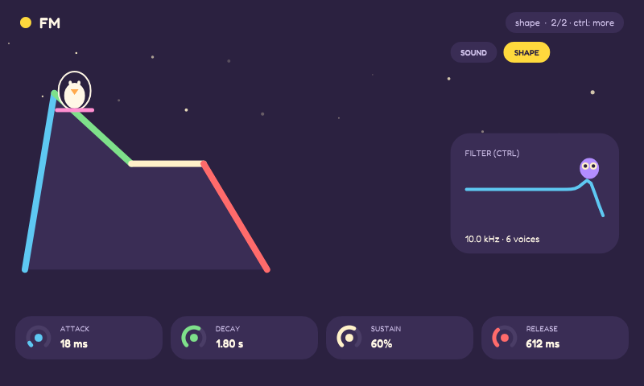

- **FM**: FM synthesis with a stack of operators (the bubbles), algorithm, ratio, amount and feedback.
- **Shape page** (right, shared by the new engines): the envelope drawn as a slope, plus the filter (Control).

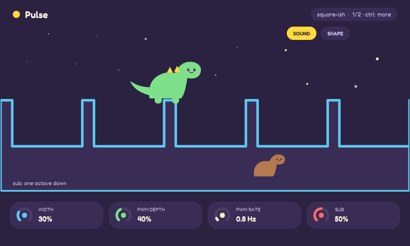 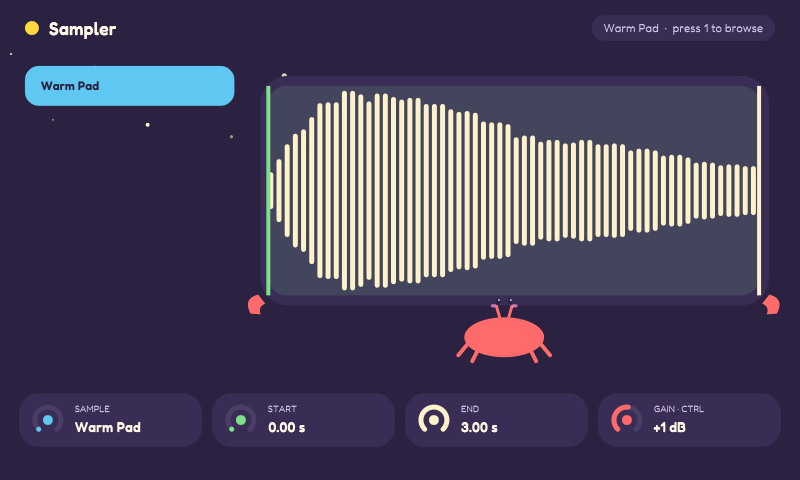

- **Pulse** (left): a pulse-wave synth with pulse width, PWM depth and rate, and a sub oscillator one octave down.
- **Sampler** (right): the sample's waveform with its start and end points. Press encoder 1 to browse your samples.

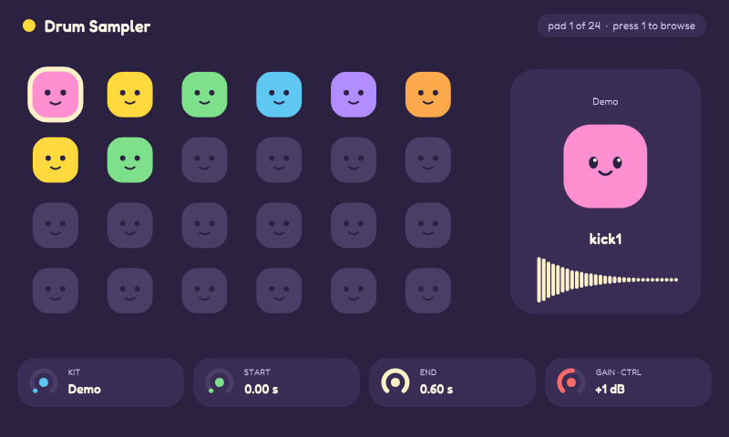

- **Drum Sampler**: 24 pads, one per key, loaded from a drum kit folder. Pick the kit with encoder 1, then set each pad's start, end and gain.

### Effects and the plugin chain

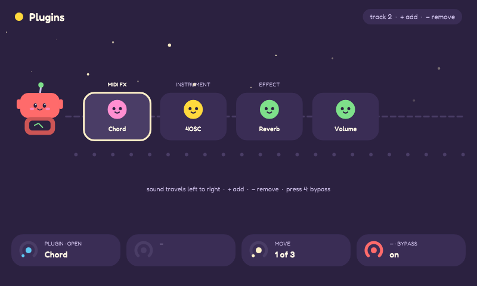 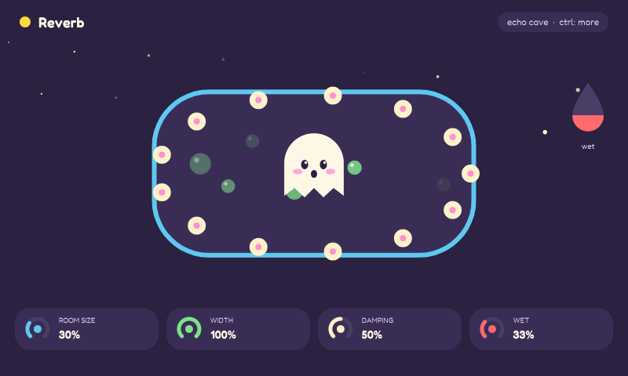

- **Plugins screen** (left): a track's chain, left to right in the order the sound travels: MIDI FX → instrument → effects → volume. Add with +, remove with −, move a plugin with encoder 3, bypass with encoder 4.
- **Effects**: 4-band equaliser, reverb (right), delay, chorus, phaser, compressor, low/high-pass filter and a new **Pitch Shift**. Each one has its own animated screen.

### MIDI FX

MIDI FX sit before the instrument and change the notes you play.


- **Chord** (above): one key plays a whole chord. Choose the chord type, inversion and voicing; the keyboard shows the notes and the cake stacks them.
- **Arpeggiator**: plays held notes one after another: mode (up, down…), rate, octaves, gate and latch.
- **Scale lock**: keeps every note in a chosen root and scale, so nothing sounds wrong.

### Modulation

Modifiers move a knob for you. Adding one takes three steps: choose the modifier, then the plugin, then the knob it should turn.

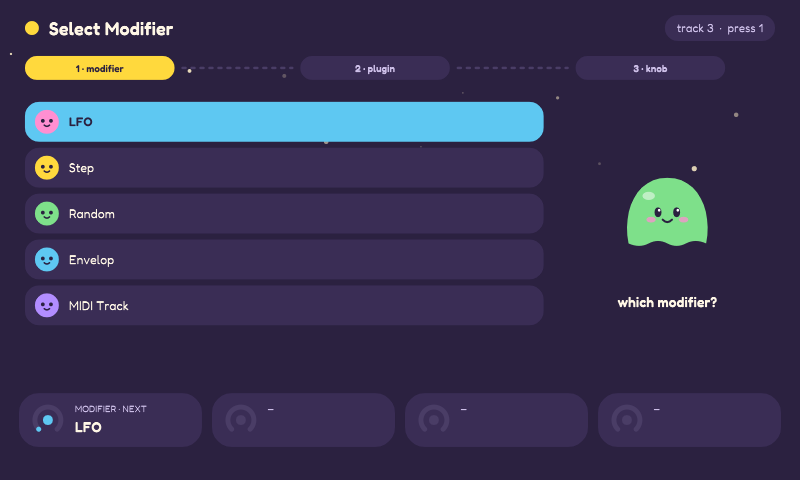 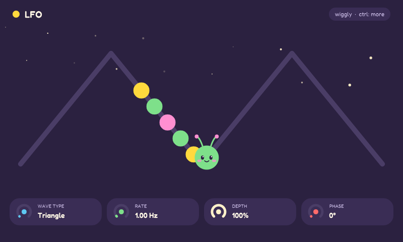

- **LFO** (right): a repeating wave (triangle, sine, square…) with rate, depth and phase.
- **Step**: a short sequence of knob positions, in time with the song.
- **Random**: a new random value at a set rate, smoothed or not.
- **Envelope**: follows how loud a sound is (an envelope follower).
- **MIDI Tracker**: follows the notes or velocities you play.

### Sequencers

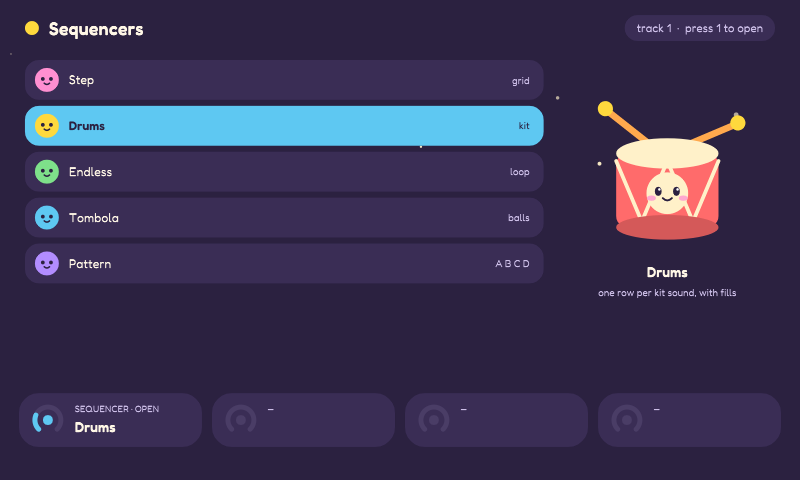  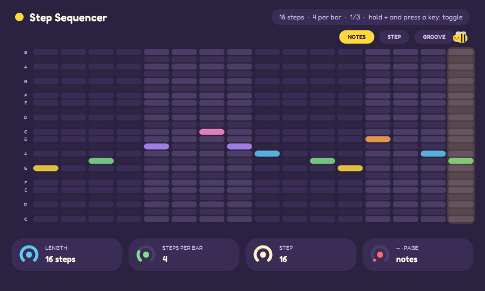
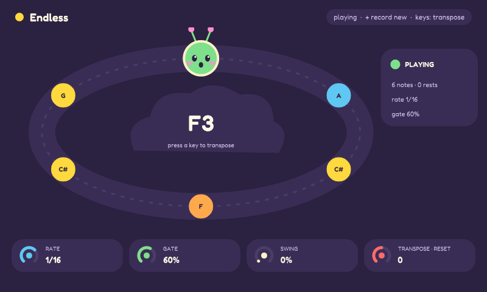  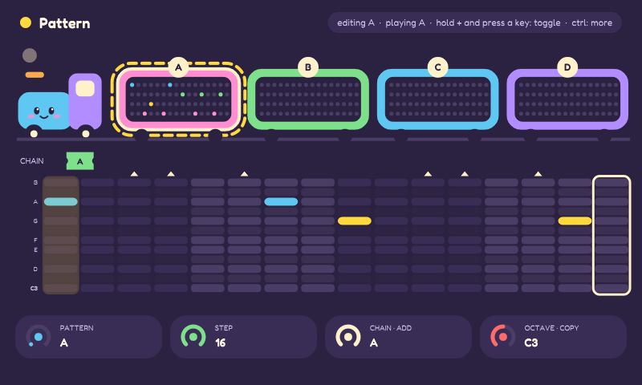

Press Sequencers to pick one for the selected track. Each writes an ordinary MIDI clip at the playhead (looped), so it plays any instrument and renders with the song. Hold + and press a key to add or remove notes; Play and Stop play the loop on its own.

- **Step**: notes on a grid. Press encoder 4 to flip between NOTES, STEP (velocity, length/tie, chance and ratchet for the framed step; hold Control to pick the step, or to change every step at once) and GROOVE (swing, gate, direction, humanize).
- **Drums**: one row per kit sound, up to 64 steps. Encoders: sound, step, length, velocity (press: clear). Hold Control: level, swing, steps per bar, fill (press: edit the fill pattern, which replaces the main one every 2, 4 or 8 passes). While playing, + and a key drops a hit on the step that is playing.
- **Endless**: press + and play notes one at a time (− adds a rest), + again to finish. While it plays, a key transposes the loop. Encoders: rate, gate, swing, transpose (press: reset).
- **Tombola**: each key drops a ball (up to 8), − removes the newest. Balls bounce in a spinning shape and play their note when they hit a wall. Encoders: spin, gravity, sides, bounce (press: shake).
- **Pattern**: four 16-step patterns A to D played in a chain. Encoders: pattern, step, chain link (press: add a link; with Control turn to change its letter, press to remove it), octave shown (press: copy the pattern to the next letter).

### Mixer


Each track is a test tube showing its level, with the master on the left. Encoder 3 is pan (Control: solo), encoder 4 is volume (Control: mute). The small dots above each tube are the **aux sends A and B**, for sharing one reverb or delay between tracks.

### VST3 plugins

VST3 plugins in `~/.vst3`, `/usr/lib/vst3` or `/usr/local/lib/vst3` show up under Instruments or Effects in the plugin list. They are scanned once and remembered in `~/.config/LMN-3/plugins.xml`; the folders are only scanned again when a plugin is added, removed or updated. A plugin that crashes the scan is skipped from then on.

A VST3 plugin opens on a playful screen that works with the encoders. A *knob map* (a small YAML file in `~/.config/LMN-3/knob_maps`) picks its useful parameters and groups them into pages of 8: 4 on the encoders and 4 more while holding Control; +/− change page. Parameters that aren't in the map follow on "MORE" pages, and a plugin without a map gets every parameter, 8 to a page. Press encoder 1 to browse the plugin's presets (turn 1: preset, turn 2: bank of 16, press 1: load, press 2 or Stop: back).

Maps for OB-Xd and Dexed are written to that folder the first time the app starts, so you can edit them or copy one as a starting point for another plugin:

```yaml
plugin: OB-Xd
match: [obxd, ob-xd]        # parts of the plugin name, any case
pages:
  - name: FILTER
    knobs:
      - CUTOFF = Cutoff      # LABEL = parameter name
      - RES = Resonance|Reso # | lists other spellings
      - ""                   # an empty slot
```

#### Installing Dexed and OB-Xd on the Raspberry Pi
Both are part of [DISTRHO Ports](https://github.com/DISTRHO/DISTRHO-Ports), which can build them without their GUIs (the LMN-3 doesn't need them):

```
sudo apt install -y git meson ninja-build pkg-config libfftw3-dev libfreetype-dev libx11-dev libxext-dev libasound2-dev
git clone --depth 1 https://github.com/DISTRHO/DISTRHO-Ports.git
cd DISTRHO-Ports
meson setup build --buildtype release -Dplugins=dexed,obxd -Dbuild-lv2=false -Dbuild-vst2=false -Dbuild-juce5-only=true -Dlinux-headless=true
ninja -C build
mkdir -p ~/.vst3
find build -name "*.vst3" -maxdepth 4 -exec cp -r {} ~/.vst3/ \;
```

Then restart the LMN-3: the next time you add a plugin it finds them (the first scan takes a few seconds).

### Power off

Hold **Control + Stop** for 3 seconds: the project is saved and the Pi shuts down safely.

## Sounds: samples and drum kits

The fastest way: [docs/SAMPLES.md](docs/SAMPLES.md). It covers:
- the free **Starter** drum kit in [`drum_kits/Starter`](drum_kits/Starter): 16 sounds made from scratch, free to share;
- [`tools/op1_to_lmn3.py`](tools/op1_to_lmn3.py), which turns **OP-1 patches** (for example from [op1.fun](https://op1.fun)) and ordinary **sample packs** into LMN-3 samples and drum kits, `.yaml` files included;
- copying sounds from a computer to the Pi.

### Samples
Place any audio sample files you wish to use with the Sampler plugin in `~/.config/LMN-3/samples`. 

### Drum Kits
Drum kits are handled a bit differently than regular samples. Drum kits are essentially directories located in 
`~/.config/LMN-3/drum_kits`, with each kit directory containing a `.yaml` mapping file along with any sample files 
associated with it. 

As an example, suppose I want to make a drum kit called AwesomeDrumKit. I would first create a directory in 
`~/.config/LMN-3/drum_kits` named AwesomeDrumKit.
```
mkdir ~/.config/LMN-3/drum_kits/AwesomeDrumKit
```

I would then add all the samples I want to use in that kit into that 
newly created AwesomeDrumKit folder (if you are doing this using the file browser you will need to make sure
and show hidden folders since `.config` is hidden.) Then I would create the yaml file:
```
touch  ~/.config/LMN-3/drum_kits/AwesomeDrumKit/AwesomeDrumKit.yaml
```
Notice that the `.yaml` file has the same name as its parent directory. You would then edit the file and define the mapping that states which sample is played by which midi note number:
```yaml
name: "AwesomeDrumKit"
mappings:
  - note_number: "53"
    file_name: "cool_sample.wav"
  - note_number: "54"
    file_name: "wacky_sample.wav"
  - note_number: "55"
    file_name: "crazy_sample.wav"
```

53 is the first note in the `+0` octave. You can add mappings for the entire note range from 5 to 124. To skip the manual work, [`tools/op1_to_lmn3.py`](tools/op1_to_lmn3.py) builds the folder and the `.yaml` file for you from a folder of samples (see [docs/SAMPLES.md](docs/SAMPLES.md)).

## Settings (config.yaml)

If you wish to configure the application, you can add a `config.yaml` file to `~/.config/LMN-3`. 
You can configure whether to show a title bar, the width and height of the application window, and
whether the plugin screens are animated (`animations`, on by default; set it to `false` to keep the
playful plugin screens still, e.g. to save CPU). You can also configure a basic color scheme (it only changes the few screens that are not drawn in the playful style; leave it out to get the playful palette everywhere). An example
config file is shown below:
```yaml
config:
  show-title-bar: false
  animations: true
  size:
    width: 800
    height: 480
  colours:
    backgroundColour: "ff1d2021"
    textColour: "fff9f5d7"
    colour1: "ff458588"
    colour2: "ff689d6a"
    colour3: "fff9f5d7"
    colour4: "ffcc241d"
    colour5: "ff98971a"
    colour6: "ffd65d0e"
    colour7: "ffb16286"
    colour8: "ffd79921"
```

The first time you run the application, the directories `~/.config/LMN-3/samples` and 
`~/.config/LMN-3/drum kits` will be automatically created. See the sections below for details on how to add
synth samples and drum kits to the application.

**The easy way:** see [docs/SAMPLES.md](docs/SAMPLES.md). This fork includes a free **Starter** drum kit ([`drum_kits/Starter`](drum_kits/Starter)) and [`tools/op1_to_lmn3.py`](tools/op1_to_lmn3.py), which turns OP-1 patches (e.g. from [op1.fun](https://op1.fun)) and ordinary sample packs into LMN-3 samples and drum kits, `.yaml` files included.

## Branches

| Branch | For |
|---|---|
| **`lmn3`** | The original LMN-3 hardware (800 × 480 screen). Software changes only. **Use this one.** |
| **`lmn3-v3-wide`** | **Limoncello**, a new hardware design based on the LMN-3 (7.9" 1280 × 400 screen, built-in speakers and mic). Everything in `lmn3`, plus a wide screen layout, a MIC key (record and sample from the built-in mic) and a joystick click (sustain). |
| `main` | An unchanged copy of the original project. |

## For developers

- **Building on a computer:** the same steps as [above](#install-or-update-on-your-lmn-3), without `--target LMN-3`, also build the example plugins and the test suite. Run the tests with `./build/Tests/Tests_artefacts/Release/Tests`.
- **Cross-compiling for the Pi:** see the original project's [release workflow](https://github.com/FundamentalFrequency/LMN-3-DAW/blob/master/.github/workflows/release.yaml).
- **Windows and Android builds:** [`.github/workflows/windows.yaml`](.github/workflows/windows.yaml) and [`.github/workflows/android.yaml`](.github/workflows/android.yaml). The Android project is written by [`Android/make_project.py`](Android/make_project.py) and JUCE's Projucer.
- **The original releases**, without this fork's changes, are [here](https://github.com/FundamentalFrequency/LMN-3-DAW/releases).
- **No LMN-3?** Besides the keyboard and touch modes, there's the original [LMN-3-Emulator](https://github.com/FundamentalFrequency/LMN-3-Emulator), which sends the same MIDI messages as the hardware.

## Contributing

Pull requests are welcome and very much appreciated. Please read the [contributing guide](https://github.com/FundamentalFrequency/LMN-3-DAW/blob/master/contributing.md) 
before submitting a pull request.

If you'd like to support the original author, consider becoming a [sponsor](https://github.com/sponsors/stonepreston).

## Thanks

This project would not be possible without the following free and open source projects:
- [JUCE](https://github.com/juce-framework/JUCE)
- [Tracktion Engine](https://github.com/Tracktion/tracktion_engine)
- [googletest](https://github.com/google/googletest)
- [yaml-cpp](https://github.com/jbeder/yaml-cpp)
- [FontAwesome](https://github.com/FortAwesome/Font-Awesome)
- [CMake](https://gitlab.kitware.com/cmake/cmake)
- [The LLVM Project](https://github.com/llvm/llvm-project)
- [Raspberry Pi](https://github.com/raspberrypi)

and many others.

## License

Licensed under the [GPL 3.0](https://www.gnu.org/licenses/gpl-3.0.en.html) license.

This repository also includes the [yaml-cpp](https://github.com/jbeder/yaml-cpp) library which requires the following 
notice be included:

```
Copyright (c) 2008-2015 Jesse Beder.

Permission is hereby granted, free of charge, to any person obtaining a copy
of this software and associated documentation files (the "Software"), to deal
in the Software without restriction, including without limitation the rights
to use, copy, modify, merge, publish, distribute, sublicense, and/or sell
copies of the Software, and to permit persons to whom the Software is
furnished to do so, subject to the following conditions:

The above copyright notice and this permission notice shall be included in
all copies or substantial portions of the Software.

THE SOFTWARE IS PROVIDED "AS IS", WITHOUT WARRANTY OF ANY KIND, EXPRESS OR
IMPLIED, INCLUDING BUT NOT LIMITED TO THE WARRANTIES OF MERCHANTABILITY,
FITNESS FOR A PARTICULAR PURPOSE AND NONINFRINGEMENT. IN NO EVENT SHALL THE
AUTHORS OR COPYRIGHT HOLDERS BE LIABLE FOR ANY CLAIM, DAMAGES OR OTHER
LIABILITY, WHETHER IN AN ACTION OF CONTRACT, TORT OR OTHERWISE, ARISING FROM,
OUT OF OR IN CONNECTION WITH THE SOFTWARE OR THE USE OR OTHER DEALINGS IN
THE SOFTWARE.
```
