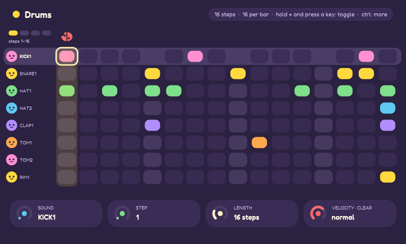

# LMN-3-DAW (extended fork)
[](https://www.gnu.org/licenses/gpl-3.0)

**This is a fork of [FundamentalFrequency/LMN-3-DAW](https://github.com/FundamentalFrequency/LMN-3-DAW)**, the software for the [LMN-3](https://github.com/FundamentalFrequency) DIY groovebox by Stone Preston. It runs on the same LMN-3 hardware and keeps everything the original does, and adds:

| Area | What's new |
|---|---|
| Look | Every screen redrawn in a "playful" style: animated characters for each plugin, modifier and sequencer, with the four knob boxes along the bottom matching the four encoders |
| Projects | Several projects instead of one, with a Projects browser in Settings |
| Editing | Quantize with swing (Control + Cut), render menu with stems and loop-range renders, sampler fixes |
| Sound | Built-in **String**, **FM** and **Pulse** synth engines; **Pitch Shift** effect; aux sends **A/B** on the Mixer |
| MIDI FX | **Arpeggiator**, **scale lock** and **chord** |
| Modulation | **Step**, **Random**, **Envelope follower** and **MIDI tracker** modulators |
| Sequencers | **Drums**, **Endless**, **Tombola** and **Pattern** sequencers, and an upgraded **Step** sequencer |
| Plugins | **VST3** instruments and effects on the encoders, with knob maps and a preset browser |
| Power | Hold Control + Stop for 3 seconds to save and switch off |
| Other platforms | A **Windows** version played with the computer keyboard and mouse, and an **Android** phone app with on-screen keys, buttons and encoders |

  
  

**[See every new feature, with pictures →](FEATURES.md)**

The original project's [overview video](https://www.youtube.com/watch?v=h5UmPTttN1s) still shows the hardware and the basic workflow. If you'd like to support the original author, consider becoming a [sponsor](https://github.com/sponsors/stonepreston).

## Downloads

Built automatically by GitHub on every change: open the [Actions tab](https://github.com/HotPTgz/LMN-3-DAW/actions), click the newest run with a green tick for the branch you want, and download from **Artifacts** at the bottom:
- **LMN-3-windows**: unzip and double-click `LMN-3.exe`; press F12 for the keys.
- **LMN-3-android**: unzip on the phone and open `LMN-3.apk` (allow installing from that app when asked).

For the Raspberry Pi, build from source (below).

## Branches

| Branch | For |
|---|---|
| **`lmn3`** (default) | The original LMN-3 hardware (800 × 480 screen). Software changes only. |
| **`lmn3-v3-wide`** | **Limoncello**, a new hardware design based on the LMN-3 (7.9" 1280 × 400 screen, built-in speakers and mic). Everything in `lmn3`, plus a wide screen layout, a MIC key (record and sample from the built-in mic) and a joystick click (sustain). |
| `main` | An unchanged copy of the original project. |

## Releases of the original project
The original project's releases (without the changes in this fork) are [here](https://github.com/FundamentalFrequency/LMN-3-DAW/releases). A release contains executables for 
x86_64, ARM, and aarch64 architectures. The aarch64 bit version of the application is recommended for running on the Pi. 
Note that this does require you to run the 64-Bit version of the Raspberry Pi OS if you are not already.

## Configuration
If you wish to configure the application, you can add a `config.yaml` file to `~/.config/LMN-3`. 
You can configure whether to show a title bar, the width and height of the application window, and
whether the plugin screens are animated (`animations`, on by default; set it to `false` to keep the
playful plugin screens still, e.g. to save CPU). You can also configure a basic color scheme (it only changes the few screens that are not drawn in the playful style; leave it out to get the playful palette everywhere). An example
config file is shown below:
```yaml
config:
  show-title-bar: false
  animations: true
  size:
    width: 800
    height: 480
  colours:
    backgroundColour: "ff1d2021"
    textColour: "fff9f5d7"
    colour1: "ff458588"
    colour2: "ff689d6a"
    colour3: "fff9f5d7"
    colour4: "ffcc241d"
    colour5: "ff98971a"
    colour6: "ffd65d0e"
    colour7: "ffb16286"
    colour8: "ffd79921"
```

### Wide screens (Limoncello, 7.9" 1280 × 400)
This branch is the software for [Limoncello](https://github.com/HotPTgz/Limoncello), the LMN-3 successor with Hall-effect keys and a 7.9" screen.

Any window more than 2.2 times as wide as it is tall gets the wide layout: the header runs across the top, the screen's
picture fills the left, and the four knob boxes sit in a 2 × 2 panel on the right, in the same order as the v3's
encoders (1 2 on top, 3 4 below). For the Waveshare 7.9" monitor set:
```yaml
config:
  show-title-bar: false
  size:
    width: 1280
    height: 400
```
The monitor starts in portrait (400 × 1280). Turn it sideways in Raspberry Pi OS with **Screen Configuration**
(Layout → Orientation), or on the command line with `wlr-randr --output HDMI-A-1 --transform 90`
(use the output name `wlr-randr` lists, and `270` if the picture is upside down).

### Limoncello controls
These need the [Limoncello Teensy firmware](https://github.com/HotPTgz/Limoncello/tree/main/firmware) (it sends CC 113–115):

| Control | What it does |
| --- | --- |
| Joystick click | Sustain, like a sustain pedal, while held (4OSC, String, FM, Pulse) |
| Control + joystick click | Switches the joystick's up/down mod wheel on or off (the firmware remembers it) |
| MIC | Arms the built-in mic on the selected track: the next **Record** records sound from it. MIC again turns it off. The mic is never played through the speakers, so it can't howl. |
| Control + MIC | Samples: make a sound and press MIC again (it stops by itself after 20 s). The silence around it is trimmed. A drum sampler asks which pad to put it on (play the key), a sampler gets it across the keys, and a track with no instrument gets a new sampler. It is always saved in `samples/Recorded` too. |

On a computer (`LMN3_KEYBOARD=1`), F9 is MIC and F10 the joystick click. `LMN3_FAKE_MIC=1` replaces the mic with a
test tone for sampling, for computers without one.

The first time you run the application, the directories `~/.config/LMN-3/samples` and 
`~/.config/LMN-3/drum kits` will be automatically created. See the sections below for details on how to add
synth samples and drum kits to the application.

### Samples
Place any audio sample files you wish to use with the Sampler plugin in `~/.config/LMN-3/samples`. 

### Drum Kits
Drum kits are handled a bit differently than regular samples. Drum kits are essentially directories located in 
`~/.config/LMN-3/drum_kits`, with each kit directory containing a `.yaml` mapping file along with any sample files 
associated with it. 

As an example, suppose I want to make a drum kit called AwesomeDrumKit. I would first create a directory in 
`~/.config/LMN-3/drum_kits` named AwesomeDrumKit.
```
mkdir ~/.config/LMN-3/drum_kits/AwesomeDrumKit
```

I would then add all the samples I want to use in that kit into that 
newly created AwesomeDrumKit folder (if you are doing this using the file browser you will need to make sure
and show hidden folders since `.config` is hidden.) Then I would create the yaml file:
```
touch  ~/.config/LMN-3/drum_kits/AwesomeDrumKit/AwesomeDrumKit.yaml
```
Notice that the `.yaml` file has the same name as its parent directory. You would then edit the file and define the mapping that states which sample is played by which midi note number:
```yaml
name: "AwesomeDrumKit"
mappings:
  - note_number: "53"
    file_name: "cool_sample.wav"
  - note_number: "54"
    file_name: "wacky_sample.wav"
  - note_number: "55"
    file_name: "crazy_sample.wav"
```

This is a manual process. 53 is the first note in the `+0` octave. You can add mappings for the entire note range from 5 to 124. If you want to make
a drum kit, you will need to create the directory to store the kit in, add the audio files to it, and then create the
`.yaml` mapping file. Perhaps someone could make a JUCE application to make this easier (cough...cough).

## VST3 Plugins
VST3 plugins in `~/.vst3`, `/usr/lib/vst3` or `/usr/local/lib/vst3` show up under Instruments or Effects in the plugin list. They are scanned once and remembered in `~/.config/LMN-3/plugins.xml`; the folders are only scanned again when a plugin is added, removed or updated. A plugin that crashes the scan is skipped from then on.

A VST3 plugin opens on a playful screen that works with the encoders. A *knob map* (a small YAML file in `~/.config/LMN-3/knob_maps`) picks its useful parameters and groups them into pages of 8: 4 on the encoders and 4 more while holding Control; +/− change page. Parameters that aren't in the map follow on "MORE" pages, and a plugin without a map gets every parameter, 8 to a page. Press encoder 1 to browse the plugin's presets (turn 1: preset, turn 2: bank of 16, press 1: load, press 2 or Stop: back).

Maps for OB-Xd and Dexed are written to that folder the first time the app starts, so you can edit them or copy one as a starting point for another plugin:

```yaml
plugin: OB-Xd
match: [obxd, ob-xd]        # parts of the plugin name, any case
pages:
  - name: FILTER
    knobs:
      - CUTOFF = Cutoff      # LABEL = parameter name
      - RES = Resonance|Reso # | lists other spellings
      - ""                   # an empty slot
```

### Installing Dexed and OB-Xd on the Raspberry Pi
Both are part of [DISTRHO Ports](https://github.com/DISTRHO/DISTRHO-Ports), which can build them without their GUIs (the LMN-3 doesn't need them):

```
sudo apt install -y git meson ninja-build pkg-config libfftw3-dev libfreetype-dev libx11-dev libxext-dev libasound2-dev
git clone --depth 1 https://github.com/DISTRHO/DISTRHO-Ports.git
cd DISTRHO-Ports
meson setup build --buildtype release -Dplugins=dexed,obxd -Dbuild-lv2=false -Dbuild-vst2=false -Dbuild-juce5-only=true -Dlinux-headless=true
ninja -C build
mkdir -p ~/.vst3
find build -name "*.vst3" -maxdepth 4 -exec cp -r {} ~/.vst3/ \;
```

Then restart the LMN-3: the next time you add a plugin it finds them (the first scan takes a few seconds).

## Sequencers
Press Sequencers to pick one for the selected track. Each writes an ordinary MIDI clip at the playhead (looped), so it plays any instrument and renders with the song. Hold + and press a key to add or remove notes; Play and Stop play the loop on its own.

- **Step**: notes on a grid. Press encoder 4 to flip between NOTES, STEP (velocity, length/tie, chance and ratchet for the framed step; hold Control to pick the step, or to change every step at once) and GROOVE (swing, gate, direction, humanize).
- **Drums**: one row per kit sound, up to 64 steps. Encoders: sound, step, length, velocity (press: clear). Hold Control: level, swing, steps per bar, fill (press: edit the fill pattern, which replaces the main one every 2, 4 or 8 passes). While playing, + and a key drops a hit on the step that is playing.
- **Endless**: press + and play notes one at a time (− adds a rest), + again to finish. While it plays, a key transposes the loop. Encoders: rate, gate, swing, transpose (press: reset).
- **Tombola**: each key drops a ball (up to 8), − removes the newest. Balls bounce in a spinning shape and play their note when they hit a wall. Encoders: spin, gravity, sides, bounce (press: shake).
- **Pattern**: four 16-step patterns A to D played in a chain. Encoders: pattern, step, chain link (press: add a link; with Control turn to change its letter, press to remove it), octave shown (press: copy the pattern to the next letter).

## Building From Source

### Dependencies
If you wish to build the project from source, you will also need to run the following command to install the build
dependencies:
```bash
sudo apt install libasound2-dev libjack-jackd2-dev \
    ladspa-sdk \
    libcurl4-openssl-dev  \
    libfreetype6-dev \
    libx11-dev libxcomposite-dev libxcursor-dev libxcursor-dev libxext-dev libxinerama-dev libxrandr-dev libxrender-dev \
    libwebkit2gtk-4.0-dev \
    libglu1-mesa-dev mesa-common-dev \
    build-essential cmake clang llvm lld
```

### Cloning the Repository
This repository relies on git submodules. You must clone the submodules as well using:
```bash
git clone --recurse-submodules https://github.com/FundamentalFrequency/LMN-3-DAW
```

### Building the Project
CMake is used to build the project. Execute the following commands to build all project targets:
```bash
cmake -B build -DCMAKE_CXX_COMPILER=clang++ -DCMAKE_C_COMPILER=clang -DCMAKE_BUILD_TYPE=Release -DCMAKE_CXX_FLAGS=-fuse-ld=lld
cmake --build build -j8
```
You will find the corresponding artifacts in the build directory that was created using the commands above. 
`./build/LMN3_artefacts/Release` will contain the main LMN-3 executable. 

### Compiling for the Raspberry Pi
If you want to build the DAW for the Raspberry Pi, you will need to either build it on the Pi itself (takes a fair bit of time),
or cross compile it. Cross compilation is outside the scope of this document, but you can take a look at the 
[release workflow](https://github.com/FundamentalFrequency/LMN-3-DAW/blob/master/.github/workflows/release.yaml) for insight on 
how it works.

Note that if you do build on the Pi you will need at least 4 GB of RAM.

## Running the Test Suite
After building the project using the commands above, you can run the test suite by executing the following command:
```bash
./build/Tests/Tests_artefacts/Release/Tests
```

## LMN-3-Emulator
If you lack LMN-3 hardware with which to control the DAW (or just want a more convenient method for testing purposes), 
you can use the [LMN-3-Emulator](https://github.com/FundamentalFrequency/LMN-3-Emulator) directly on your desktop. The emulator
sends the very  same MIDI commands as the actual LMN-3 hardware, though it is missing a few features.

## Contributing
Pull requests are welcome and very much appreciated. Please read the [contributing guide](https://github.com/FundamentalFrequency/LMN-3-DAW/blob/master/contributing.md) 
before submitting a pull request.

## Thanks
This project would not be possible without the following free and open source projects:
- [JUCE](https://github.com/juce-framework/JUCE)
- [Tracktion Engine](https://github.com/Tracktion/tracktion_engine)
- [googletest](https://github.com/google/googletest)
- [yaml-cpp](https://github.com/jbeder/yaml-cpp)
- [FontAwesome](https://github.com/FortAwesome/Font-Awesome)
- [CMake](https://gitlab.kitware.com/cmake/cmake)
- [The LLVM Project](https://github.com/llvm/llvm-project)
- [Raspberry Pi](https://github.com/raspberrypi)

and many others. 

## License
Licensed under the [GPL 3.0](https://www.gnu.org/licenses/gpl-3.0.en.html) license.

This repository also includes the [yaml-cpp](https://github.com/jbeder/yaml-cpp) library which requires the following 
notice be included:

```
Copyright (c) 2008-2015 Jesse Beder.

Permission is hereby granted, free of charge, to any person obtaining a copy
of this software and associated documentation files (the "Software"), to deal
in the Software without restriction, including without limitation the rights
to use, copy, modify, merge, publish, distribute, sublicense, and/or sell
copies of the Software, and to permit persons to whom the Software is
furnished to do so, subject to the following conditions:

The above copyright notice and this permission notice shall be included in
all copies or substantial portions of the Software.

THE SOFTWARE IS PROVIDED "AS IS", WITHOUT WARRANTY OF ANY KIND, EXPRESS OR
IMPLIED, INCLUDING BUT NOT LIMITED TO THE WARRANTIES OF MERCHANTABILITY,
FITNESS FOR A PARTICULAR PURPOSE AND NONINFRINGEMENT. IN NO EVENT SHALL THE
AUTHORS OR COPYRIGHT HOLDERS BE LIABLE FOR ANY CLAIM, DAMAGES OR OTHER
LIABILITY, WHETHER IN AN ACTION OF CONTRACT, TORT OR OTHERWISE, ARISING FROM,
OUT OF OR IN CONNECTION WITH THE SOFTWARE OR THE USE OR OTHER DEALINGS IN
THE SOFTWARE.
```
